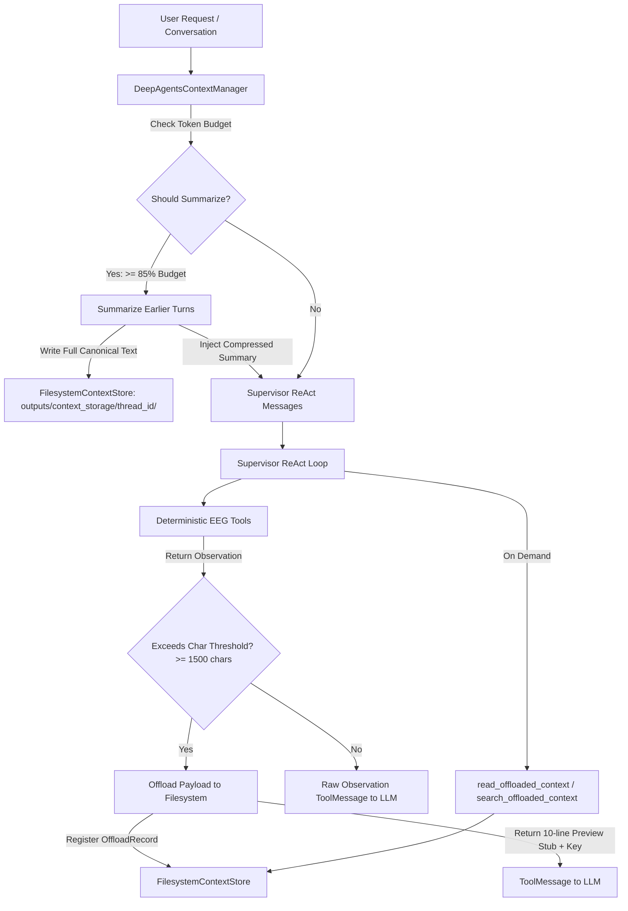

# LangChain Deep Agents Context Management Architecture

## 1. Overview & Motivation

The CDAC WBL EEG Functional Connectivity Pipeline processes high-density electroencephalography (EEG) recordings (64–256 channels, continuous timeseries, and multi-condition trial splits). Operating within constrained model context windows—such as Groq's 8,192 token limit and local vLLM instances—frequently exposed the pipeline to context exhaustion when raw channel tables or diagnostic events were fed directly into the model reasoning loop.

This implementation integrates official **LangChain Deep Agents Context Management** patterns directly into the pipeline without replacing the deterministic MNE-Python analysis or the LangGraph StateGraph architecture.

---

## 2. Architecture & Core Components

### Component Details

1. **`FilesystemContextStore`** ([`src/fc_pipeline/pipeline/context_management.py`](file:///c:/Users/sanje/OneDrive/Desktop/fc_pipeline_enhanced_v4/fc_pipeline_full_updated_v2/fc_pipeline/fc_pipeline/src/fc_pipeline/pipeline/context_management.py)):
   - Thread-isolated storage backend rooted at `outputs/context_storage/{thread_id}/`.
   - Generates content-addressed files with SHA-256 digests (`{tool_name}_{call_id}_{digest}.txt`).
   - Ensures strict thread partition: thread A offloads cannot be read or overwritten by thread B.

2. **`DeepAgentsContextManager`** ([`src/fc_pipeline/pipeline/context_management.py`](file:///c:/Users/sanje/OneDrive/Desktop/fc_pipeline_enhanced_v4/fc_pipeline_full_updated_v2/fc_pipeline/fc_pipeline/src/fc_pipeline/pipeline/context_management.py)):
   - **Tool Result Offloading (`maybe_offload_tool_result`)**: Checks tool output string length against `DEEPAGENTS_TOOL_OFFLOAD_CHAR_THRESHOLD` (default: 1,500 characters). Offloads large payloads to disk and substitutes a compact pointer stub containing the first 10 lines of preview and the retrieval key.
   - **Context Recovery Tools (`build_retrieval_tools`)**: Dynamically exposes two tools to the LLM when offloads exist:
     - `read_offloaded_context(key: str)`: Loads the complete, original payload from disk.
     - `search_offloaded_context(query: str)`: Scans offloaded files for matching snippets with line numbers.
   - **Sliding-Window Conversation Summarization (`summarize_messages`)**: When the message sequence approaches `DEEPAGENTS_SUMMARIZATION_RATIO` (default: 85%) of `DEEPAGENTS_CONTEXT_TOKEN_LIMIT` (default: 8,000 tokens), older messages are compressed into a structured summary. The complete verbatim history is preserved to disk, while the system prompt and the latest tail turns are kept untouched.
   - **Context Overflow Recovery**: Catches provider token overflow exceptions (`ContextOverflowError`, rate/budget errors) during `invoke()`, dynamically compresses history, and retries.

3. **Separation of Long-Term Memory from Transient Context**:
   - Persistent user preferences (e.g., preferred frequency bands, default montage, metric sets) remain isolated in [`src/fc_pipeline/pipeline/user_memory.py`](file:///c:/Users/sanje/OneDrive/Desktop/fc_pipeline_enhanced_v4/fc_pipeline_full_updated_v2/fc_pipeline/fc_pipeline/src/fc_pipeline/pipeline/user_memory.py) under `user_memory/{user_id}_preferences.json`.
   - Short-term conversation summaries and offloaded tool outputs live under `outputs/context_storage/{thread_id}/`.
   - Ground truth datasets (channels, sampling frequency, conditions) and explicit human Gate 1 decisions always override historical user defaults.

---

## 3. Relevant Files & Integration Touchpoints

| File | Purpose |
|------|---------|
| [`src/fc_pipeline/pipeline/context_management.py`](file:///c:/Users/sanje/OneDrive/Desktop/fc_pipeline_enhanced_v4/fc_pipeline_full_updated_v2/fc_pipeline/fc_pipeline/src/fc_pipeline/pipeline/context_management.py) | Core engine: `FilesystemContextStore`, `DeepAgentsContextManager`, retrieval tools, token estimation. |
| [`src/fc_pipeline/agentic/supervisor/agent.py`](file:///c:/Users/sanje/OneDrive/Desktop/fc_pipeline_enhanced_v4/fc_pipeline_full_updated_v2/fc_pipeline/fc_pipeline/src/fc_pipeline/agentic/supervisor/agent.py) | Supervisor ReAct loop integration: offloading tool outputs, exposing retrieval tools, pre-invocation summarization, overflow recovery. |
| [`src/fc_pipeline/pipeline/nodes.py`](file:///c:/Users/sanje/OneDrive/Desktop/fc_pipeline_enhanced_v4/fc_pipeline_full_updated_v2/fc_pipeline/fc_pipeline/src/fc_pipeline/pipeline/nodes.py) | LangGraph node adapters; input rail pre-filter preserving EEG request context across revisions. |
| [`chainlit_app.py`](file:///c:/Users/sanje/OneDrive/Desktop/fc_pipeline_enhanced_v4/fc_pipeline_full_updated_v2/fc_pipeline/fc_pipeline/chainlit_app.py) | Multi-turn chat interface preserving thread isolation, Gate 1 reviews, and post-run follow-ups. |
| [`tests/unit/test_deepagents_context_management.py`](file:///c:/Users/sanje/OneDrive/Desktop/fc_pipeline_enhanced_v4/fc_pipeline_full_updated_v2/fc_pipeline/fc_pipeline/tests/unit/test_deepagents_context_management.py) | Dedicated unit test suite verifying offloading, recovery, summarization, thread isolation, and HITL preservation. |

---

## 4. Configuration

The context management engine is configurable via standard environment variables:

| Variable | Default | Description |
|----------|---------|-------------|
| `DEEPAGENTS_CONTEXT_TOKEN_LIMIT` | `8000` | Target token limit for conversation history. |
| `DEEPAGENTS_TOOL_OFFLOAD_CHAR_THRESHOLD` | `1500` | Tool outputs exceeding this character count are offloaded to filesystem. |
| `DEEPAGENTS_SUMMARIZATION_RATIO` | `0.85` | Fraction of token limit (85%) that triggers automatic conversation summarization. |
| `DEEPAGENTS_PRESERVED_TAIL_MESSAGES` | `4` | Number of most recent conversation messages preserved verbatim when compressing. |

---

## 5. Verification & Test Results

A full regression suite verified all context management and existing pipeline features:

1. **Deep Agents Context Management Suite** (`tests/unit/test_deepagents_context_management.py`):
   - `test_estimate_tokens`: PASSED
   - `test_filesystem_context_store_thread_isolation`: PASSED
   - `test_tool_result_offloading_under_threshold`: PASSED
   - `test_tool_result_offloading_over_threshold`: PASSED
   - `test_recovery_of_offloaded_information`: PASSED
   - `test_conversation_history_summarization_trigger_and_compression`: PASSED
   - `test_user_preferences_isolated_from_transient_context`: PASSED
   - `test_hitl_clarification_state_preservation_under_context_management`: PASSED
   *(8/8 passed)*

2. **HITL & Gate 1 Regression Suite** (`tests/unit/agentic/test_hitl_clarification.py` and `tests/integration/test_architectural_breakpoints.py`):
   - 38/38 passed (including Gate 1 resume, Request Changes, channel option bounds, injection protection).

3. **User Memory M5 Suite** (`tests/unit/test_user_memory_m5.py`):
   - 14/14 passed.

4. **Deterministic MNE Data Preparation Suite** (`tests/unit/deterministic/`):
   - 235 passed, 4 skipped (validating filtering, epoching, montage application, bad-channel screening).

---

## 6. Limitations & Notes

- **Connectivity Agent**: As specified in requirements, Node 3 (Connectivity Agent) was intentionally not implemented and remains isolated for future phases.
- **Provider Multi-Modal Limits**: Plot inspection during post-run follow-up gracefully falls back to deterministic plot metadata when endpoints lack vision capabilities.
- **Thread Storage Cleanup**: Context storage artifacts persist under `outputs/context_storage/{thread_id}/` for auditing. A cron or background cleanup routine can be scheduled if disk conservation is required in production deployments.
